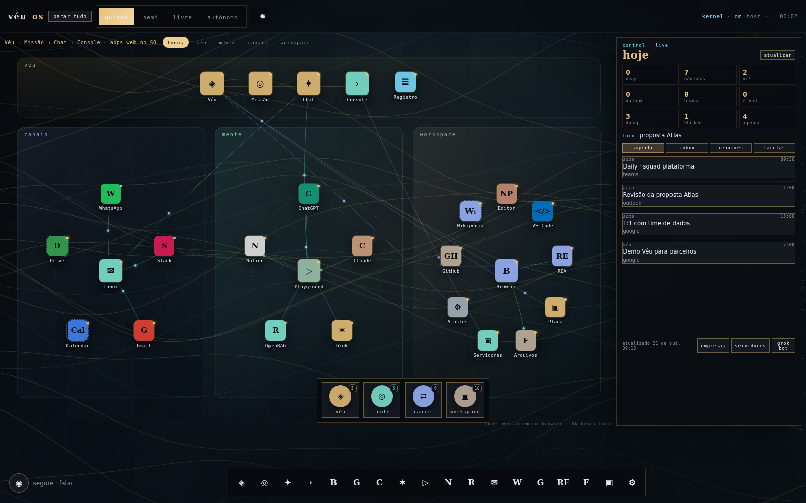
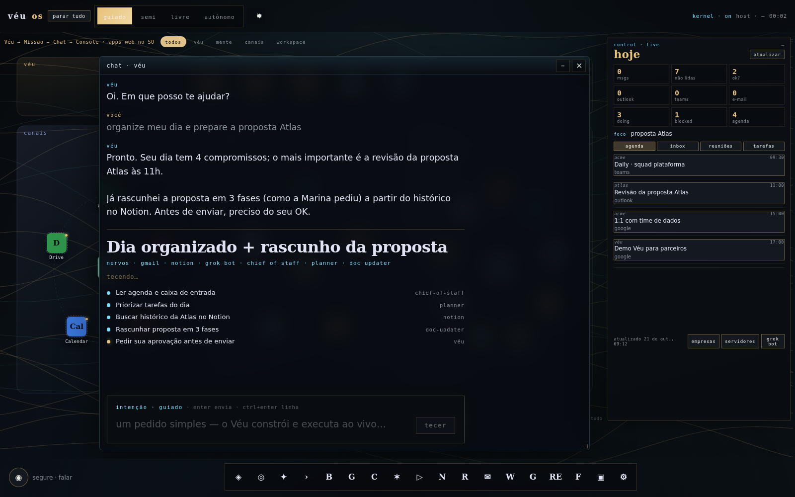
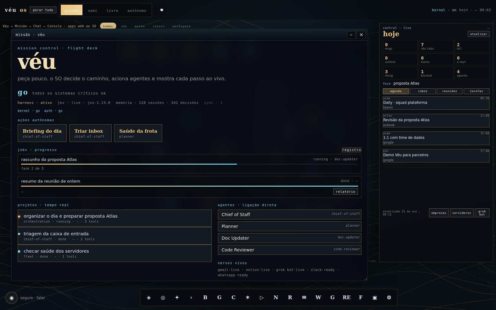
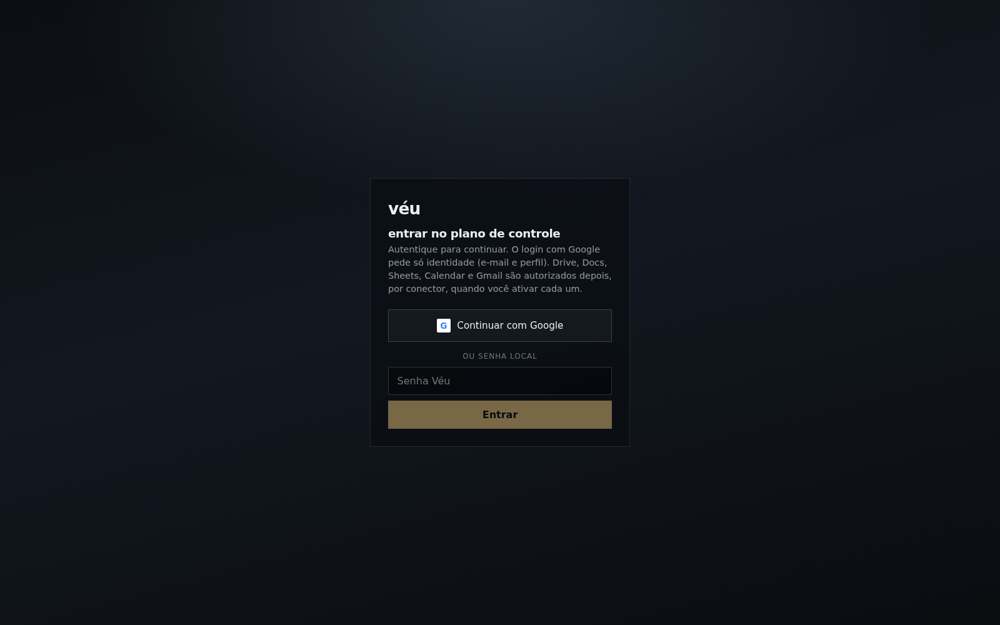
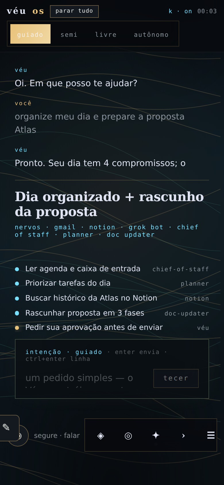
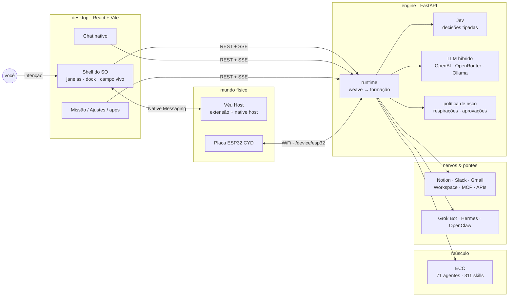
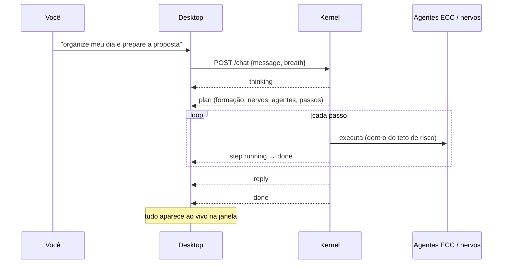

<div align="center">


# Véu

**Um sistema operacional administrado por IA.**
Roda sobre Windows ou Linux: o kernel do host continua no lugar, e o Véu é a membrana que *administra*, *conversa*, *constrói* e *executa* em tempo real.

[](desktop/)
[](desktop/)
[](engine/)
[](engine/)
[](https://github.com/hudsonrj/ECC)
[](LICENSE)

[O que é](#-o-que-é) · [Telas](#-telas) · [Arquitetura](#-arquitetura) · [Começar](#-começar) · [Documentação](#-documentação) · [Roadmap](#-roadmap)

<br />



</div>

---

## ✦ O que é

O Véu não é um "app de chat". É um **desktop web vivo**, com janelas, dock, ícones e um campo animado, onde a IA é o administrador do sistema. Você pede pouco; o SO decide o caminho, aciona agentes e mostra **cada passo ao vivo**.

| | |
|---|---|
| 💬 **Chat nativo** | Conversa com o administrador de IA, sem jargão interno e sem clonar a interface de chatbots. |
| ⚡ **Execução ao vivo** | Cada pedido vira uma *formação*: plano, nervos, agentes e passos transmitidos por SSE enquanto acontecem. |
| 🫁 **Três respirações de autonomia** | `guiado` · `semi` · `livre`, além do modo `autônomo`, que varre o SO e traz propostas. O teto de risco de cada ação acompanha a respiração. |
| 🧠 **Músculo ECC** | 71 agentes e 311 skills do [ECC](https://github.com/hudsonrj/ECC) operando por baixo da pele, sem aparecer como "plugin". |
| 🔌 **Nervos** | Notion, Slack, Gmail, Google Workspace, WhatsApp, Teams, Outlook, MCP e APIs genéricas. |
| 🌉 **Pontes de IA** | Grok Bot (colônia cloud always-on), Hermes (learning loop), OpenClaw (gateway de canais) e Jev (decisões tipadas). |
| 🖥️ **Ponte física** | A extensão de navegador *Véu Host* com Native Messaging dá ao SO acesso a shell, arquivos e apps do computador real. A **Placa ESP32** é um painel touch físico. |
| 🛡️ **Plano de controle fechado** | Login Google OAuth ou senha, cookie HttpOnly, CSRF, aprovações humanas, botão **parar tudo** e auditoria. |

## ◎ Telas

<table>
<tr>
<td width="50%"></td>
<td width="50%"></td>
</tr>
<tr>
<td align="center"><b>Chat + execução ao vivo</b><br/><sub>Um pedido simples vira plano, nervos, agentes e passos em tempo real.</sub></td>
<td align="center"><b>Missão · flight deck</b><br/><sub>Go/no-go, jobs com progresso, projetos e agentes ligados.</sub></td>
</tr>
<tr>
<td></td>
<td align="center"></td>
</tr>
<tr>
<td align="center"><b>Plano de controle</b><br/><sub>Google OAuth ou senha local; nada roda sem sessão.</sub></td>
<td align="center"><b>Mobile / PWA</b><br/><sub>Layout compacto, instalável como app.</sub></td>
</tr>
</table>

> As capturas usam dados de demonstração fictícios.

## ⬡ Arquitetura



Um pedido no chat passa por este ciclo:



Mais detalhes em [`docs/ARQUITETURA.md`](docs/ARQUITETURA.md).

## ▷ Começar

**Requisitos:** Node 20+, Python 3.10+, git.

```bash
git clone --recurse-submodules https://github.com/hudsonrj/veu.git
cd veu
```

**1. Kernel (engine)**

```bash
cd engine
python3 -m venv .venv && .venv/bin/pip install -e ".[llm,mcp]"
cp ../.env.example .env            # preencha as chaves e defina VEU_AUTH_PASSWORD
echo "VEU_AUTH_COOKIE_SECURE=0" >> .env   # só em dev (http)
export VEU_ECC_ROOT=$PWD/../vendor/ecc
.venv/bin/veu serve --host localhost --port 8821
```

**2. Desktop**

```bash
cd desktop
npm install
VITE_VEU_KERNEL=http://localhost:8821 npm run dev
```

Abra http://localhost:5173 e entre com a senha definida em `VEU_AUTH_PASSWORD`.

> Use `localhost` nos dois lados: o cookie de sessão é `SameSite=Strict`, e `localhost` e `127.0.0.1` contam como sites diferentes.

**3. CLI**

```bash
veu pulse                                  # saúde do kernel, ECC e nervos
veu weave "resuma minha inbox" --breath semi
```

Para produção (systemd + Caddy + TLS), a extensão Véu Host e a placa ESP32, veja [`docs/INSTALACAO.md`](docs/INSTALACAO.md).

## ☰ Estrutura

```
veu/
├── desktop/        # a pele: SO web em React 19 + Vite + framer-motion
│   └── src/
│       ├── os/         # shell: TopBar, Dock, janelas, ícones, DayRail, apps/
│       ├── components/ # campo vivo, chat nativo, execução ao vivo, órbita de autonomia
│       └── lib/        # cliente do kernel, SSE, fallback local (weave.ts)
├── engine/         # o kernel: FastAPI + CLI `veu`
│   └── src/veu/
│       ├── api.py      # ~240 rotas REST/SSE
│       ├── runtime.py  # weave → formação → stream
│       ├── bridges/    # Grok Bot · Hermes · OpenClaw · Control live
│       ├── connectors/ # nervos: Notion, OpenRAG, registry…
│       └── mcp/        # host MCP
├── extension/      # Véu Host: extensão de navegador + native host
├── device/         # Placa ESP32 CYD (PlatformIO)
├── docs/           # arquitetura, API, instalação, pontes de IA
└── vendor/ecc/     # submódulo ECC (agentes + skills)
```

## ❖ Documentação

| Documento | Conteúdo |
|---|---|
| [MANIFESTO](MANIFESTO.md) | O que o Véu é e o que ele administra |
| [Arquitetura](docs/ARQUITETURA.md) | Camadas, formações, respirações, segurança |
| [API do kernel](docs/API.md) | Todas as rotas REST e o protocolo SSE do chat |
| [Instalação](docs/INSTALACAO.md) | Dev local, produção, variáveis de ambiente, extensão, placa |
| [Pontes de IA](docs/AI-BRIDGES.md) | Jev, OpenClaw, Hermes e Grok Bot: o que puxar de cada um |
| [Continuidade](CONTINUIDADE.md) | Handoff para retomar o trabalho em qualquer agente |
| [Véu Host](extension/README.md) | Extensão de navegador + Native Messaging |
| [Placa ESP32](device/esp32-cyd/README.md) | Companion físico com tela touch |

## ⟶ Roadmap

- [x] Chat nativo com execução ao vivo (SSE)
- [x] Memória append-only do SO + auditoria
- [x] Pontes Grok Bot · Hermes · OpenClaw
- [x] Auth fechada (Google OAuth, senha, CSRF)
- [x] Frota de servidores com SSH pelo Véu Host
- [x] Placa ESP32 como nervo físico
- [ ] Ecossistema visual de agentes com handoff no chat
- [ ] Chief-of-staff vivo: triagem de Gmail, Outlook e WhatsApp
- [ ] Operar apps do host (WhatsApp Desktop, Teams) sob política de risco
- [ ] Empacotar o desktop (Tauri/Electron) para Windows e Linux

## Licença

[MIT](LICENSE) © 2026 Véu
