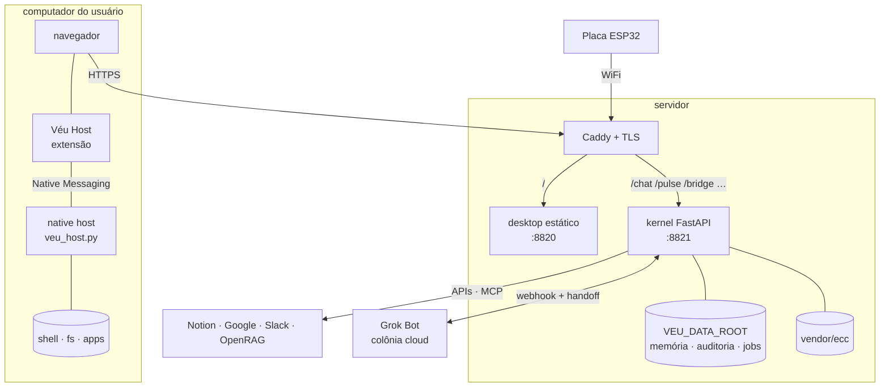

# Arquitetura do Véu

O Véu tem quatro camadas com nomes de corpo, e cada uma tem um papel claro:

| Camada | Pasta | O que faz |
|---|---|---|
| **Pele** | `desktop/` | O SO web que você vê: janelas, dock, ícones em zonas, campo vivo, chat, painel do dia. |
| **Kernel** | `engine/` | API FastAPI + CLI `veu`. Recebe intenções, tece *formações*, aplica política de risco e transmite a execução. |
| **Músculo** | `vendor/ecc/` | [ECC](https://github.com/hudsonrj/ECC): 71 agentes e 311 skills que o kernel aciona por baixo. |
| **Nervos** | `engine/src/veu/connectors/`, `bridges/`, `mcp/` | Conexões com o mundo: Notion, Gmail, Slack, MCP, APIs, Grok Bot, Hermes, OpenClaw. |

E dois braços físicos:

| Braço | Pasta | O que faz |
|---|---|---|
| **Véu Host** | `extension/` | Extensão de navegador + native host (Native Messaging): shell, arquivos, SSH e apps do computador real. |
| **Placa** | `device/esp32-cyd/` | ESP32 com tela touch de 2.8": painel físico sincronizado com o kernel. |



---

## Formações

Uma **formação** é a unidade de trabalho do Véu: a resposta do kernel para uma intenção.

```jsonc
{
  "intent": "organize meu dia e prepare a proposta Atlas",
  "breath": "semi",
  "kind": "orchestration",
  "title": "Dia organizado + rascunho da proposta",
  "connectors": [{ "id": "gmail", "surface": "api", "status": "live" }],
  "agents":     [{ "id": "chief-of-staff", "role": "triagem e agenda" }],
  "skills":     [{ "id": "email-triage" }],
  "steps":      [{ "id": "s1", "label": "Ler agenda e caixa de entrada", "actor": "chief-of-staff" }],
  "status": "running"
}
```

O fluxo dentro do kernel (`runtime.py`):

1. **Weave**: `Runtime.weave(intent, breath)` classifica a intenção (com Jev, quando configurado) e monta o plano: quais nervos, agentes ECC e passos.
2. **Harness**: a sessão recebe a lista de ferramentas permitidas e um *teto de risco* derivado da respiração.
3. **Stream**: `Runtime.stream_weave` executa os passos e emite eventos SSE para o desktop.
4. **Memória**: decisões, sessões e eventos de auditoria são gravados append-only em `VEU_DATA_ROOT`.

Sem kernel acessível, o desktop usa um fallback local (`desktop/src/lib/weave.ts`) para continuar respondendo.

## Respirações (autonomia)

| Respiração | Valor na API | Comportamento |
|---|---|---|
| **guiado** | `guided` | Propõe e espera: confirma antes de executar. |
| **semi** | `semi` | Avança sozinho e só pede aprovação para o que é delicado. |
| **livre** | `free` | Segue com autonomia dentro da política de risco. |
| **autônomo** | `autonomous` | Varre o SO e os agentes e traz um quadro de propostas para você escolher. |

O botão **parar tudo** (`POST /control/stop-all`) cancela jobs, pausa o executor e volta para `guiado`.

## LLM híbrido

O kernel escolhe o modelo por camada:

- **Jev** (`TYPESAFE_API_KEY`): decisões tipadas (*System One*): classificar, escolher e pontuar.
- **OpenAI / OpenRouter / Ollama**: geração de texto. O roteamento e as chaves são configuráveis em **Ajustes → modelos**.

## Pontes de IA

O Véu não reimplementa outros runtimes; ele se liga a eles como nervos. Detalhes em [`AI-BRIDGES.md`](AI-BRIDGES.md).

| Ponte | Papel |
|---|---|
| **Grok Bot** | Colônia cloud always-on. Recebe *handoffs* do Véu, devolve resultados por webhook e alimenta o painel **hoje** (agenda, inbox, tarefas) via `live.json`. |
| **Hermes** | Learning loop que destila sessões em skills ECC. |
| **OpenClaw** | Gateway multi-canal (Slack, Teams, Discord…). |

## Segurança

| Mecanismo | Detalhe |
|---|---|
| Sessão | Cookie `veu_session`: `HttpOnly`, `Secure`, `SameSite=Strict`. |
| Login | Google OAuth com allowlist de e-mails (`VEU_AUTH_GOOGLE_EMAILS`) e/ou senha (`VEU_AUTH_PASSWORD`). |
| CSRF | Mutações exigem `Origin`/`Referer` na allowlist e o header `X-Veu-CSRF`. |
| Rotas públicas | Só `/health`, `/healthz`, `/ready` e `/auth/*`. |
| Segredos | Ficam só em `engine/.env` (chmod 600). A UI mascara host, IP, usuário e senha. |
| Aprovações | Ações delicadas viram itens em `/approvals` e esperam decisão humana. |
| Auditoria | `GET /control/audit` (e `.csv`), com verificação de integridade em `/integrity/verify`. |
